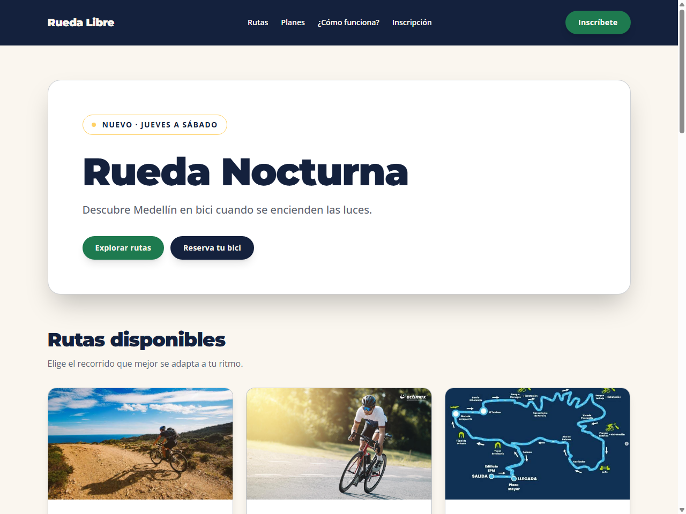
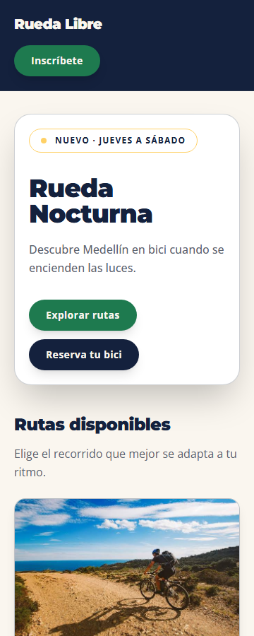
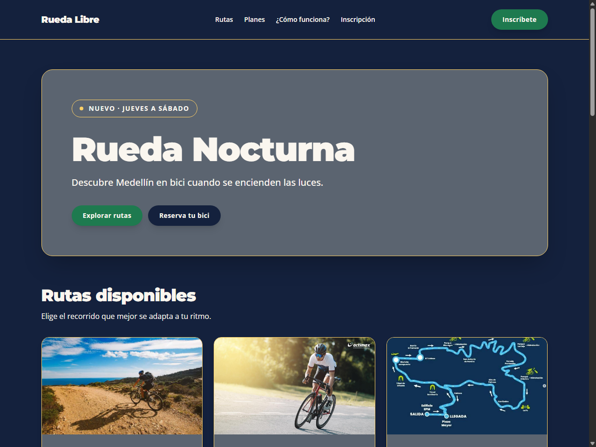

# Rueda Libre

Ecosistema web para el alquiler de bicicletas y recorridos guiados en Medellín. Reúne el sitio principal Rueda Libre v2.0 y la campaña responsive Rueda Nocturna.

## Sitio publicado

- [Inicio](https://eclipsest.github.io/rueda-libre/)
- [Tarifas](https://eclipsest.github.io/rueda-libre/paginas/tarifas.html)
- [Reservas](https://eclipsest.github.io/rueda-libre/paginas/reservas.html)
- [Landing Rueda Nocturna](https://eclipsest.github.io/rueda-libre/nocturna/index.html)
- [Kit de componentes](https://eclipsest.github.io/rueda-libre/nocturna/componentes.html)

## Páginas y tecnologías

| Producto | Páginas principales | Tecnologías |
|---|---|---|
| Rueda Libre v2.0 | Inicio, Tarifas y Reservas | HTML semántico, Bootstrap 5.3.8, Bootstrap Icons, variables CSS de marca y validación nativa |
| Rueda Nocturna | Landing y Kit de componentes | HTML semántico, Tailwind CSS 4.3.5 por CLI, tema de marca, CSS minificado y modo oscuro del sistema |

Ambos productos comparten los colores de marca, Montserrat y Open Sans. La landing incluye rutas, planes, pasos e inscripción; la página de componentes sirve como referencia visual del kit.

### Compilar Tailwind

Desde PowerShell:

```powershell
Set-Location .\nocturna
npm.cmd install
npm.cmd run build
npm.cmd run watch
```

La landing enlaza `nocturna/src/output.css`, generado y versionado para que GitHub Pages no necesite ejecutar la CLI. `node_modules/` está excluido por `.gitignore`.

## Verificación de entrega

- El validador W3C Nu reportó **cero errores** en `nocturna/index.html` y `paginas/reservas.html`.
- Los recorridos de inscripción y reserva usan controles etiquetados y validación nativa. Se probaron casos vacíos, inválidos y completos, incluida la navegación por teclado.
- En Rueda Nocturna, el foco es visible, las imágenes tienen texto alternativo y el tema oscuro responde a `prefers-color-scheme`.
- Las combinaciones principales del tema oscuro se revisaron con contraste WCAG: Crema/Gris Asfalto 5.57:1 y Crema/Azul Noche 14.83:1.
- En las pruebas de viewport no hubo desbordamiento horizontal a 360 px. La landing se adapta así:

| Ancho | Rutas | Planes | Pasos | Navegación |
|---:|---:|---:|---:|---|
| 360 px | 1 columna | 1 columna | 1 columna | Enlaces ocultos; CTA visible |
| 768 px | 2 columnas | 1 columna | 2 columnas | Visible |
| 1024 px | 3 columnas | 3 columnas | 4 columnas | Visible |
| 1280 px | 3 columnas | 3 columnas | 4 columnas | Visible |

- El sitio Bootstrap también se revisó a 360, 768 y 1280 px. La búsqueda final no encontró atributos `style` en los HTML.
- `nocturna/src/output.css` se compiló con `--minify`; tamaño final medido: **27.858 bytes**.
- Tras publicar, las cinco páginas principales y 20 recursos/enlaces internos de GitHub Pages respondieron sin errores 404.
- La inscripción de la campaña usa `mailto:info@ruedalibre.com`: el navegador valida los datos y abre la aplicación de correo; no hay almacenamiento ni confirmación automática en un servidor.

## Bootstrap vs. Tailwind — decisión del MiniReto 8

| Criterio | Evidencia y experiencia |
|---|---|
| Curva de aprendizaje | Bootstrap facilitó la grilla y los componentes habituales del sitio. Tailwind requirió componer estilos con utilidades; las clases `@apply` redujeron la repetición de botones. |
| Personalización | Bootstrap se adaptó con variables de marca y una hoja propia más pequeña. Tailwind permitió generar colores y fuentes desde `@theme` y personalizar la campaña con precisión. |
| Tamaño final | Tailwind: 27.858 B de CSS minificado local. Bootstrap 5.3.8 en Network: 33.348 B de CSS y 24.769 B de JavaScript transferidos (58.117 B en total). La medición local de Tailwind y la transferencia de Bootstrap no usan la misma compresión; no son una comparación exacta de red. |
| Casos de uso | Bootstrap encaja con el sitio multipágina y sus patrones compartidos; Tailwind es apropiado para micrositios o campañas con una identidad visual muy específica. |

**Recomendación:** mantener Bootstrap para la próxima versión integral de Rueda Libre. Ya resuelve la grilla y componentes de varias páginas, y la migración redujo en 64 % la hoja propia de distribución. Tailwind queda como buena opción para campañas independientes donde importe afinar el diseño y generar solo las utilidades utilizadas.

## Capturas

### Escritorio



### Celular



### Modo oscuro



## Demo de tres minutos

| Tiempo | Recorrido |
|---|---|
| 0:00–0:25 | Contexto: el sitio de alquiler y la campaña nocturna integrada. |
| 0:25–0:55 | Inicio de Rueda Libre: mostrar Tarifas/Reservas y abrir Rueda Nocturna desde la navegación. |
| 0:55–1:30 | Landing: explorar rutas, destacar Pareja y recorrer el formulario sin enviar datos reales. |
| 1:30–2:00 | Vista a 360 px: navegación compacta, contenido en una columna y CTA visible. |
| 2:00–2:25 | Emular modo oscuro y señalar fondos, contraste y foco. |
| 2:25–3:00 | Decisiones: Bootstrap para el sitio completo; Tailwind CLI para la campaña personalizada y su CSS generado. |

El guion está preparado para el ensayo cronometrado. La práctica frente a un compañero y su retroalimentación quedan pendientes de realizar.

## Autor

[Eclipsest](https://github.com/Eclipsest)
